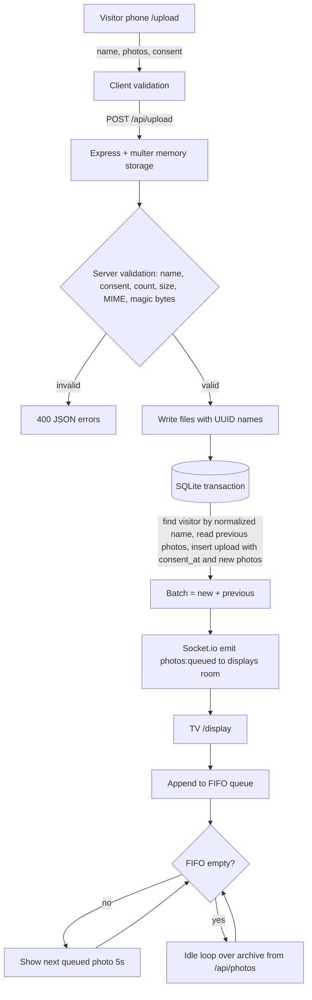

# Architecture

## Stack justification
- **Express + multer**: minimal, well-known HTTP and multipart handling.
- **SQLite (`node:sqlite`)**: single-file database, zero services to run, ships with Node 22, so no native build step. Plenty for a venue-scale photo list.
- **Socket.io**: pushes finished uploads to displays instantly, with automatic reconnect.
- **Plain HTML/JS**: two small pages need no build step. `public/js/queue.js` is a UMD module shared by the browser and the tests.

## SQLite schema
```sql
visitors(id PK, display_name, normalized_name UNIQUE, created_at)
uploads (id PK, visitor_id FK→visitors, consent_at, created_at)   -- one row per submitted batch
photos  (id PK, visitor_id FK→visitors, upload_id FK→uploads,
         filename UNIQUE, mime_type, size_bytes, created_at)
```

## System flow

